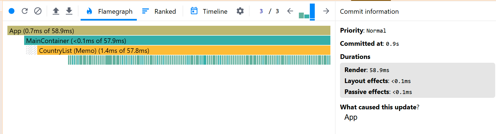
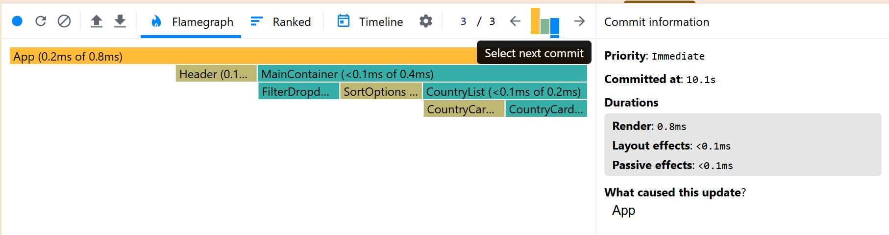

- **Commit Duration (before/after):** X ms → Y ms

**1. Reload Optimization:**
Before optimization:

After optimization:

**2. Applying the "All" Filter:**
Before optimization:

After optimization:

**3. Additional "All" Filter Scenario:**
Before optimization:

After optimization:

**4. Searching "Germany":**
Before optimization:

After optimization:

**5. Sorting:**
Before optimization:

After optimization:

**6. Switching to Visited Countries:**
Before optimization:

After optimization:

