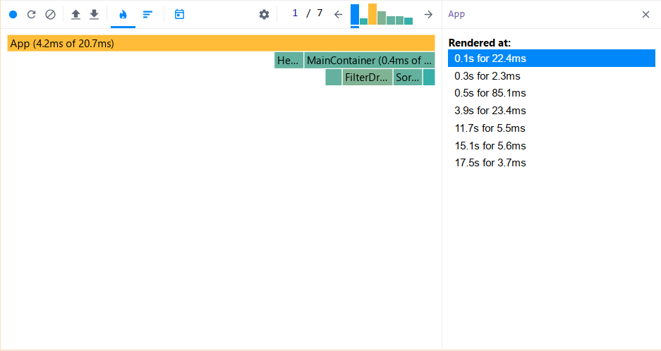

### Steps

1. Refresh the page.
2. Find the country **Austria** / reset the filter.
3. Choose sorting by **region** / reset the filter.
4. Sort by **population** → **name**.
5. Perform sorting.
6. Visit the first 3 countries / highlight them.

---

### Updated Performance Analysis

- **Commit Duration (before/after):** X ms → Y ms
  

- **Render Duration (before/after):** A ms → B ms
  

- **Flame Graph:** Components now take less time to render.
  

- **Interactions:** The number of unnecessary updates has decreased.
  
